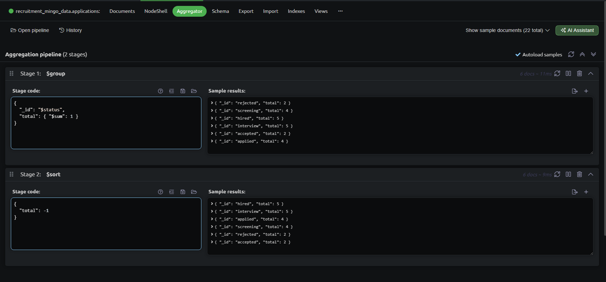
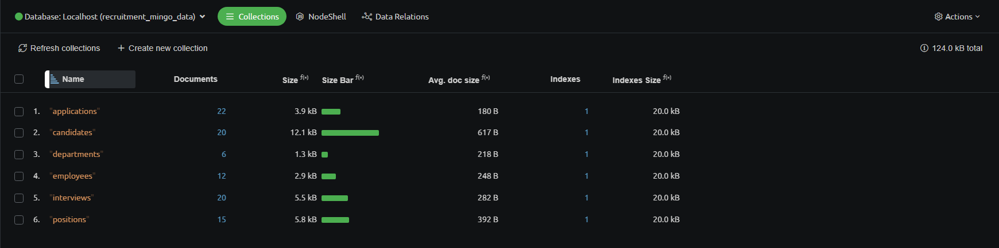
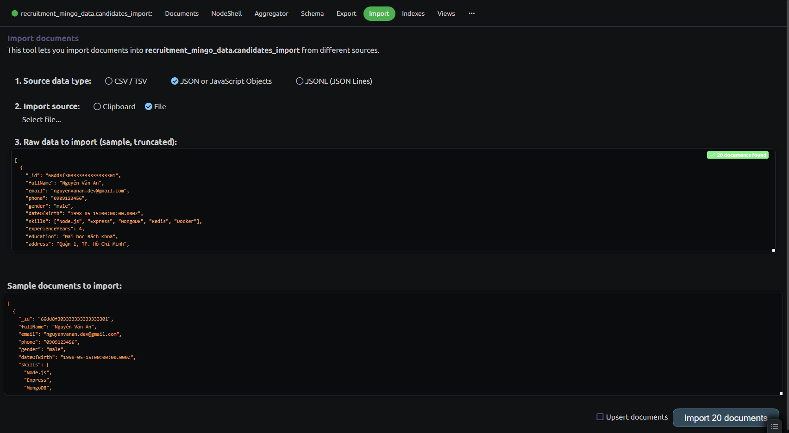
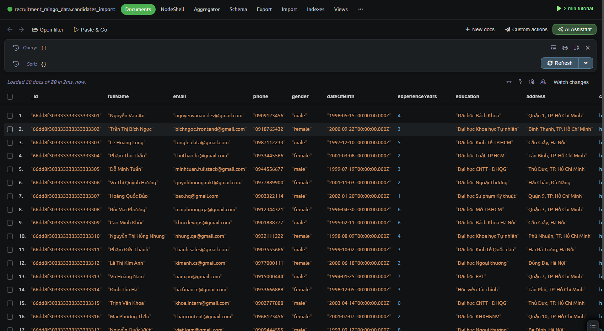
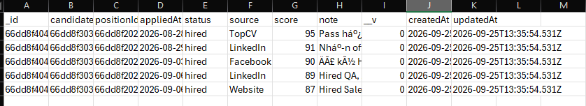
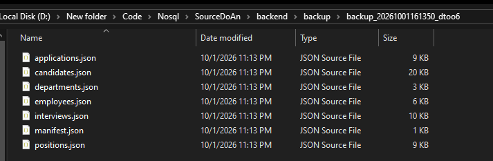
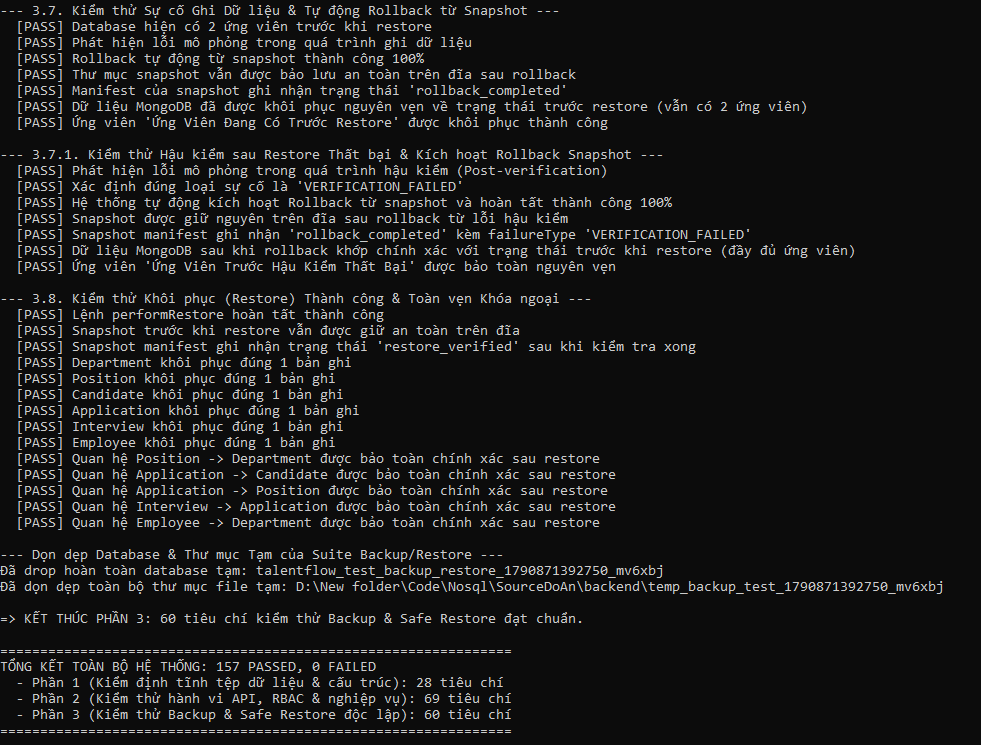

# BÁO CÁO ĐỒ ÁN CƠ SỞ DỮ LIỆU NOSQL

## Đề tài
**Tìm hiểu công cụ Mingo và xây dựng hệ thống quản lý tuyển dụng trên MongoDB**

**Nhóm thực hiện:** [Điền tên nhóm và thành viên]

**Giảng viên hướng dẫn:** [Điền tên giảng viên]

**Trường/Khoa:** [Điền theo mẫu của khoa]

**Năm học:** 2026

# MỤC LỤC

1. **Chương 1. Tìm hiểu công cụ Mingo**
   - 1.1. Mục tiêu và môi trường sử dụng
   - 1.2. Cài đặt và kết nối MongoDB
   - 1.3. Chức năng chính
   - 1.4. So sánh Mingo với MongoDB Compass
2. **Chương 2. Phân tích và thiết kế cơ sở dữ liệu**
   - 2.1. Bài toán và yêu cầu dữ liệu
   - 2.2. Mô hình tài liệu và quan hệ
   - 2.3. Thiết kế sáu collection
   - 2.4. Ràng buộc, chỉ mục và truy vấn
   - 2.5. Tạo dữ liệu, import/export, backup/restore
     - 2.5.1. Tạo cơ sở dữ liệu và dữ liệu mẫu
     - 2.5.2. Import dữ liệu
     - 2.5.3. Export dữ liệu
     - 2.5.4. Backup dữ liệu
     - 2.5.5. Restore dữ liệu
3. **Chương 3. Xây dựng ứng dụng quản lý tuyển dụng**
   - 3.1. Kiến trúc và công nghệ
   - 3.2. API, xác thực và phân quyền
   - 3.3. Luồng nghiệp vụ trên giao diện
   - 3.4. Báo cáo bằng Aggregation
   - 3.5. Kiểm thử và đánh giá
   - 3.6. Kịch bản kiểm chứng phục vụ nghiệm thu
4. Kết luận
5. Tài liệu tham khảo

# LỜI MỞ ĐẦU

Tuyển dụng nhân sự là một quá trình gồm nhiều công việc liên tiếp: đăng vị trí cần tuyển, tiếp nhận hồ sơ, sàng lọc ứng viên, tổ chức phỏng vấn và ghi nhận kết quả. Khi số lượng hồ sơ tăng lên, việc quản lý thông tin bằng các tệp riêng lẻ dễ dẫn đến trùng lặp dữ liệu, bỏ sót lịch phỏng vấn và khó theo dõi tiến độ của từng ứng viên. Một hệ thống lưu trữ và khai thác dữ liệu tập trung sẽ giúp quá trình này rõ ràng và thuận tiện hơn.

Từ nhu cầu đó, nhóm thực hiện đề tài **“Tìm hiểu công cụ Mingo để quản trị và khai thác cơ sở dữ liệu quản lý tuyển dụng nhân viên, kết hợp xây dựng ứng dụng minh họa”**. Đề tài sử dụng MongoDB để tổ chức dữ liệu về phòng ban, vị trí tuyển dụng, ứng viên, hồ sơ ứng tuyển, lịch phỏng vấn và nhân viên. Công cụ Mingo được tìm hiểu như một phương tiện hỗ trợ quan sát cấu trúc dữ liệu, thực hiện truy vấn và kiểm tra thông tin lưu trong cơ sở dữ liệu.

Bên cạnh việc thiết kế cơ sở dữ liệu, nhóm xây dựng ứng dụng web để thể hiện cách dữ liệu được sử dụng trong một quy trình tuyển dụng cụ thể. Thông qua đề tài, nhóm mong muốn vận dụng kiến thức về cơ sở dữ liệu NoSQL vào một bài toán thực tế, đồng thời hiểu rõ hơn mối liên hệ giữa thiết kế dữ liệu, công cụ quản trị và các chức năng của ứng dụng.
# CHƯƠNG 1. TÌM HIỂU CÔNG CỤ MINGO

## 1.1. Mục tiêu và môi trường sử dụng

Mingo là công cụ giao diện đồ họa dành cho MongoDB. Người dùng có thể kết nối tới máy chủ, duyệt collection, tìm và chỉnh sửa document, xem quan hệ tham chiếu, phân tích schema và xây dựng aggregation bằng giao diện. Trong đề tài này, Mingo là công cụ nghiên cứu; MongoDB Server mới là nơi lưu dữ liệu, còn ứng dụng web truy cập cơ sở dữ liệu thông qua backend Node.js. Vì vậy Mingo không nằm trên đường xử lý yêu cầu của người dùng ứng dụng.

Môi trường minh họa gồm MongoDB Community Server chạy cục bộ, cơ sở dữ liệu recruitment_db, backend Express/Mongoose và giao diện React. Có thể kết nối Mingo tới máy chủ bằng URI dạng mongodb://localhost:27017. Trước khi thao tác ghi, cần xác nhận đúng tên database; nên thử import hoặc restore trên database tạm để tránh ảnh hưởng dữ liệu trình diễn.

## 1.2. Cài đặt và kết nối

Tải bộ cài phù hợp hệ điều hành từ trang chính thức của Mingo, cài đặt và khởi chạy. Trong giao diện kết nối, nhập URI MongoDB, kiểm tra kết nối rồi chọn recruitment_db. Nếu MongoDB dùng tài khoản, URI hoặc hộp thoại kết nối phải có thông tin xác thực tương ứng. Không đưa URI có mật khẩu vào ảnh chụp báo cáo.

Sau khi kết nối, người dùng mở lần lượt sáu collection: departments, positions, candidates, applications, interviews và employees. Đây là bước kiểm tra ban đầu để đối chiếu tên collection, số bản ghi và kiểu trường với thiết kế ở Chương 2. Trường hợp không có quyền sử dụng Mingo tại thời điểm nghiệm thu, ảnh chụp từ Compass phải được ghi là ảnh Compass; không thể dùng ảnh đó để khẳng định đã thực nghiệm trên Mingo.

**[CHÈN ẢNH 1.1: cửa sổ kết nối Mingo tới recruitment_db và danh sách sáu collection.]**

*Hình 1.1. Kết nối Mingo với cơ sở dữ liệu tuyển dụng của nhóm.*

## 1.3. Các chức năng cần tìm hiểu

**Duyệt và chỉnh sửa tài liệu.** Mingo hỗ trợ xem nội dung document theo cách thuận tiện cho dữ liệu lồng nhau. Với collection candidates, có thể kiểm tra mảng skills và experience mà không cần tách chúng thành bảng độc lập. Giao diện chỉnh sửa trực tiếp phù hợp cho việc sửa một vài document mẫu; các thay đổi hàng loạt cần dùng script hoặc quy trình sao lưu trước.

**Quan hệ giữa document.** Mingo giới thiệu khả năng nhận biết tham chiếu và xem nhanh document liên quan. Trong bộ dữ liệu này, application tham chiếu candidate và position; interview tham chiếu application. Chức năng này giúp lần theo hồ sơ cụ thể khi kiểm tra dữ liệu, nhưng không thay thế kiểm tra toàn vẹn tại backend.

**Aggregation Builder.** Người dùng tạo các stage như $match, $group, $project, $lookup và xem kết quả ở từng bước. Ví dụ của đề tài là tính tỷ lệ tuyển dụng từ applications: gom toàn bộ hồ sơ bằng $group, đếm theo trạng thái bằng $cond, rồi tính tỷ lệ bằng $project. Mã truy vấn tương ứng được lưu trong docs/aggregation_queries.js.

**Schema Analyzer.** Công cụ phân tích cấu trúc tài liệu giúp quan sát trường, kiểu dữ liệu và độ nhất quán trong collection. Đây là chức năng hỗ trợ phát hiện dữ liệu bất thường; ràng buộc bắt buộc và enum của ứng dụng vẫn nằm trong Mongoose schema và mã xử lý.

**Import/export và kiểm tra chỉ mục.** Import/export hỗ trợ trao đổi dữ liệu để khảo sát hoặc chuyển một tập document. Việc xuất JSON/CSV của GUI khác với một bản backup có thể restore toàn bộ sáu collection. Chỉ mục cần được đối chiếu với Mongoose schema và kết quả Explain Plan của MongoDB, thay vì suy ra hiệu năng chỉ từ giao diện.

Các chức năng Mingo trên được mô tả theo tài liệu của nhà cung cấp. Báo cáo chưa gắn số liệu đo thao tác trực tiếp trên Mingo; việc đánh giá tốc độ hoặc RAM cần một thí nghiệm riêng với cùng tập dữ liệu và cùng máy.

**[CHÈN ẢNH 1.2: Mingo Schema Analyzer của collection candidates, thấy danh sách trường và kiểu dữ liệu.]**

*Hình 1.2. Phân tích cấu trúc collection candidates trong Mingo.*

**[CHÈN ẢNH 1.3: Mingo hiển thị liên kết candidateId từ một application sang candidate liên quan.]**

*Hình 1.3. Điều hướng tham chiếu giữa hai document trong Mingo.*

## 1.4. So sánh với MongoDB Compass

MongoDB Compass là công cụ GUI chính thức của MongoDB. Tài liệu MongoDB xác nhận Compass có duyệt và chỉnh sửa dữ liệu, Schema Analysis, Aggregation Pipeline Builder, quản lý index, Explain Plan và import/export JSON/CSV. Vì vậy không nên viết rằng những chức năng chung này chỉ có ở Mingo. Điểm quan tâm của nhóm là cách Mingo trình bày quan hệ giữa document và thao tác trên dữ liệu, trong khi Compass thuận lợi cho quy trình học tập vì tài liệu chính thức đầy đủ và nhóm đã dùng nó để lấy ảnh minh chứng.

| Tiêu chí | Mingo | MongoDB Compass |
| --- | --- | --- |
| Vai trò | GUI bên thứ ba cho MongoDB | GUI do MongoDB phát triển |
| Duyệt, sửa document | Có, nhấn mạnh thao tác trực tiếp | Có |
| Aggregation, schema, index | Có các chức năng được giới thiệu trên trang sản phẩm | Có và có tài liệu hướng dẫn chính thức |
| Xem tham chiếu | Nhà cung cấp giới thiệu Relations và xem nhanh document liên quan | Có các công cụ duyệt và mô hình hóa dữ liệu; cách trình bày khác Mingo |
| Import/export | Cần xác nhận theo phiên bản và giấy phép đang dùng | Hỗ trợ JSON/CSV; không được xem export CSV là backup đầy đủ |
| Giấy phép và tài liệu | Cần kiểm tra điều kiện sử dụng hiện hành trên trang Mingo | Compass có bản tải miễn phí và tài liệu chính thức |

Nhóm chọn Mingo làm đối tượng tìm hiểu theo yêu cầu đề tài. Compass được dùng làm công cụ đối chiếu và là nguồn của các ảnh đã chụp ở phần thực hành. Chưa có số đo trên cùng máy nên báo cáo không kết luận công cụ nào tiêu thụ ít RAM hoặc chạy truy vấn nhanh hơn. Với ứng dụng quản lý tuyển dụng, giá trị thực tế của cả hai công cụ nằm ở việc quan sát dữ liệu và kiểm tra truy vấn; quyền ghi/xóa trên database vẫn phải được quản lý riêng.

Với ứng dụng quản lý dữ liệu dạng document có mảng và tham chiếu ObjectId, như hệ thống tuyển dụng, quản lý nội dung hoặc danh mục sản phẩm, Mingo hữu ích để xem nhanh cấu trúc lồng nhau và lần theo dữ liệu liên quan. Nó không phải công cụ quản trị thay cho hệ CSDL quan hệ dùng SQL. Mức độ phù hợp thực tế còn phụ thuộc giấy phép, quy mô dữ liệu và cách nhóm làm việc; báo cáo chỉ kết luận về chức năng, chưa kết luận về hiệu năng.

# CHƯƠNG 2. PHÂN TÍCH VÀ THIẾT KẾ CƠ SỞ DỮ LIỆU

## 2.1. Bài toán và yêu cầu dữ liệu

Ứng dụng phục vụ một quy trình tuyển dụng nội bộ: phòng nhân sự tạo vị trí, lưu ứng viên, ghi hồ sơ ứng tuyển vào từng vị trí, sắp lịch và đánh giá phỏng vấn, lập đề nghị làm việc rồi ghi nhận người được nhận thành nhân viên. Một ứng viên có thể có nhiều hồ sơ ứng tuyển; từng hồ sơ gắn với đúng một vị trí. Lịch phỏng vấn thuộc về hồ sơ ứng tuyển, không thuộc trực tiếp về candidate, vì cùng một người có thể được phỏng vấn cho nhiều vị trí khác nhau.

Các thao tác dữ liệu chính gồm: tra cứu ứng viên theo tên, email, kỹ năng và kinh nghiệm; lọc vị trí theo phòng ban và trạng thái; xem các hồ sơ trong sáu cột Kanban; liệt kê lịch phỏng vấn; thống kê tỷ lệ tuyển và thời gian tuyển dụng. Dữ liệu nhạy cảm gồm email, số điện thoại, lương đề nghị và mật khẩu tài khoản nội bộ. Các thao tác truy cập phải đi qua xác thực và phân quyền backend.

Trong bộ dữ liệu mẫu của project có 6 phòng ban, 15 vị trí, 20 ứng viên, 22 hồ sơ ứng tuyển, 20 lịch phỏng vấn và 12 nhân viên. Đây là số lượng trong các file seed JSON được bộ kiểm thử kiểm tra, không phải cam kết số bản ghi hiện tại của database đang chạy. Dữ liệu mới do người dùng tạo có thể làm số lượng thực tế thay đổi.

## 2.2. Mô hình tài liệu và quan hệ

Hệ thống dùng sáu collection. Dữ liệu nhỏ, luôn được đọc cùng hồ sơ ứng viên như skills và experience được nhúng trong candidate. Những thực thể có vòng đời riêng được tách thành collection và nối bằng ObjectId. Cách này tránh nhân bản thông tin vị trí vào mỗi application; đổi tên vị trí không cần sửa hàng loạt application. Đổi lại, một số màn hình phải dùng populate hoặc $lookup để hiển thị tên ứng viên và tên vị trí.

| Quan hệ | Trường tham chiếu | Lý do tách riêng |
| --- | --- | --- |
| Department → Position | positions.departmentId | Một phòng ban có nhiều vị trí |
| Candidate → Application | applications.candidateId | Một ứng viên có thể ứng tuyển nhiều lần |
| Position → Application | applications.positionId | Một vị trí nhận nhiều hồ sơ |
| Application → Interview | interviews.applicationId | Một hồ sơ có thể có lịch và lần đánh giá riêng |
| Candidate → Employee | employees.candidateId | Chỉ tạo khi ứng viên được tiếp nhận |
| Department/Position → Employee | employees.departmentId/positionId | Lưu vị trí công tác của nhân viên |

**[CHÈN SƠ ĐỒ 2.1: sáu collection và các liên kết ObjectId theo bảng quan hệ.]**

*Hình 2.1. Quan hệ giữa sáu collection; mũi tên biểu diễn tham chiếu ObjectId.*

Một cập nhật liên quan nhiều collection không tự động trở thành giao dịch nguyên tử. Backend thực hiện tiền kiểm tra rồi cập nhật tuần tự; thiết kế hiện tại chạy trên MongoDB standalone cục bộ và không dùng multi-document transaction. Vì vậy cần mô tả đúng giới hạn nhất quán khi báo cáo ứng dụng.

## 2.3. Thiết kế sáu collection

### 2.3.1. departments

Collection này lưu danh mục phòng ban. Trường name bắt buộc và unique; code được chuẩn hóa chữ hoa nhưng trong schema hiện hành không khai báo unique. description và manager là thông tin tùy chọn. Mongoose thêm createdAt và updatedAt.

| Trường | Kiểu | Vai trò |
| --- | --- | --- |
| _id | ObjectId | Định danh document |
| name | String | Tên phòng ban, bắt buộc, unique |
| code | String | Mã phòng ban, chuyển chữ hoa |
| description | String | Mô tả nhiệm vụ |
| manager | String | Người phụ trách |
| createdAt, updatedAt | Date | Dấu thời gian do Mongoose tạo |

### 2.3.2. positions

Mỗi vị trí thuộc một department. title và description là dữ liệu bắt buộc; quantity tối thiểu 1. salary là tài liệu nhúng gồm min và max. status nhận open, closed hoặc paused; closedByQuota đánh dấu trường hợp tự đóng vì đủ chỉ tiêu. Mảng requirements lưu các yêu cầu của vị trí.

| Trường | Kiểu | Vai trò |
| --- | --- | --- |
| departmentId | ObjectId | Tham chiếu departments, bắt buộc |
| title, description | String | Tên và nội dung vị trí, bắt buộc |
| requirements | String[] | Danh sách yêu cầu |
| salary.min, salary.max | Number | Khoảng lương tham khảo |
| quantity | Number | Chỉ tiêu tuyển, tối thiểu 1 |
| status | String enum | open, closed, paused |
| closedByQuota | Boolean | Phân biệt tự đóng theo chỉ tiêu |
| location, level | String | Địa điểm và cấp bậc |

### 2.3.3. candidates

Candidate lưu một người ứng tuyển độc lập với từng đơn ứng tuyển. Email bắt buộc, chuyển chữ thường và có unique index; fullName và phone bắt buộc. skills là mảng chuỗi, experience là mảng tài liệu con gồm company, position, startDate, endDate, description. Trường experienceYears dùng cho lọc theo số năm kinh nghiệm. Model không có expectedSalary.

| Trường | Kiểu | Vai trò |
| --- | --- | --- |
| fullName, email, phone | String | Thông tin liên hệ bắt buộc |
| gender, dateOfBirth | String enum, Date | Thông tin cá nhân |
| skills | String[] | Kỹ năng |
| experienceYears | Number | Số năm kinh nghiệm, tối thiểu 0 |
| education | String | Trình độ |
| experience | Document[] | Lịch sử công việc nhúng |
| currentStatus | String enum | Trạng thái tóm tắt của ứng viên |
| address, cvUrl, notes | String | Thông tin tùy chọn |

### 2.3.4. applications

Application là thực thể trung tâm của Kanban, liên kết candidate và position. appliedAt cho biết ngày nộp; status có sáu giá trị applied, screening, interview, accepted, hired, rejected. source, score và note phục vụ theo dõi. Đề nghị làm việc được lưu ngay trong application bằng offerSalary, offerStartDate, offerNote và offerAccepted; đây là dữ liệu nội bộ, chưa phải thư điện tử tự động gửi cho ứng viên.

| Trường | Kiểu | Vai trò |
| --- | --- | --- |
| candidateId, positionId | ObjectId | Hai tham chiếu bắt buộc |
| appliedAt | Date | Thời điểm nộp |
| status | String enum | Sáu bước Kanban |
| source | String | Kênh nhận hồ sơ |
| score | Number | Điểm 0–100 |
| note | String | Ghi chú nghiệp vụ |
| offerSalary, offerStartDate | Number, Date | Lương và ngày bắt đầu |
| offerNote, offerAccepted | String, Boolean | Ghi chú và xác nhận đề nghị |

### 2.3.5. interviews

Interview tham chiếu application. Các trường interviewer và scheduledAt bắt buộc. round, type và location mô tả buổi phỏng vấn. result nhận pending, pass, fail; score nằm trong 0–100. Một application có thể có nhiều lần phỏng vấn, do đó chỉ xét đúng lịch và kết quả tương ứng khi chuyển trạng thái.

| Trường | Kiểu | Vai trò |
| --- | --- | --- |
| applicationId | ObjectId | Tham chiếu application, bắt buộc |
| interviewer, scheduledAt | String, Date | Người phỏng vấn và thời gian |
| round, type, location | String | Vòng, hình thức, địa điểm |
| score | Number | Điểm 0–100 |
| result | String enum | pending, pass, fail |
| feedback, comment | String | Nội dung đánh giá |

### 2.3.6. employees

Employee gồm nhân viên được tạo thủ công và ứng viên được chuyển đổi sau tuyển dụng. Email unique; departmentId và positionId bắt buộc; candidateId là tham chiếu tùy chọn. role nhận admin, hr, interviewer hoặc employee. status nhận probation, active hoặc resigned. officialSalary và startDate được điền từ đề nghị khi chuyển đổi ứng viên trúng tuyển.

| Trường | Kiểu | Vai trò |
| --- | --- | --- |
| candidateId | ObjectId | Liên kết ứng viên khi có |
| fullName, email | String | Thông tin nhân viên bắt buộc |
| password | String | Giá trị xác thực; tài khoản mới được băm bcrypt |
| role | String enum | admin, hr, interviewer, employee |
| departmentId, positionId | ObjectId | Phòng ban và vị trí, bắt buộc |
| startDate, officialSalary | Date, Number | Ngày vào làm và lương |
| status | String enum | probation, active, resigned |

Dữ liệu demo cũ có thể còn mật khẩu thô 123456. Backend hỗ trợ chuyển sang bcrypt khi đăng nhập thành công; không nên viết rằng toàn bộ mật khẩu trong database hiện hành đã được băm. Tài khoản mới do model tạo được băm trước khi lưu.

## 2.4. Ràng buộc, chỉ mục và truy vấn

Mongoose kiểm tra trường bắt buộc, enum và khoảng số. Backend bổ sung kiểm tra quan hệ và quy tắc nghiệp vụ: không nhận hồ sơ mới vào vị trí closed; không xóa vị trí đã có application; chỉ ghi hired sau khi có đề nghị đủ thông tin và được xác nhận; khi đủ quantity thì tự đóng vị trí. MongoDB không tự tạo foreign key như CSDL quan hệ, nên tính hợp lệ của ObjectId tham chiếu phải được kiểm tra trong ứng dụng và bộ kiểm thử.

| Collection | Chỉ mục trong model | Mục đích |
| --- | --- | --- |
| departments | name unique | Tránh trùng tên phòng ban |
| candidates | email unique; fullName + email text; experienceYears; skills; currentStatus | Tra cứu và lọc |
| applications | positionId + status; candidateId | Kanban theo vị trí/trạng thái |
| interviews | scheduledAt + result | Tra cứu lịch |
| employees | email unique; role + status | Đăng nhập và lọc vai trò |

Chỉ tạo chỉ mục khi phù hợp truy vấn thực tế. Chỉ mục tăng tốc đọc nhưng chiếm dung lượng và làm phát sinh chi phí cập nhật. Kết quả Explain Plan cần ghi winning plan, totalDocsExamined, totalKeysExamined và executionTimeMillis trên cùng dữ liệu trước khi kết luận cải thiện hiệu năng. Báo cáo này không đưa ra hệ số tăng tốc giả định.

**Truy vấn cơ bản 1:** tìm các vị trí đang mở theo phòng ban bằng điều kiện departmentId và status. **Truy vấn cơ bản 2:** tìm ứng viên có experienceYears từ ba năm trở lên và skills chứa React. **Truy vấn cơ bản 3:** liệt kê application của một vị trí, sắp theo appliedAt giảm dần. Các truy vấn có thể thực hiện ở Compass hoặc Mingo sau khi đổi ObjectId mẫu thành ID thực tế trong database.

**Truy vấn nâng cao 1:** kết hợp applications với candidates và positions để hiện tên ứng viên, vị trí và trạng thái. **Truy vấn nâng cao 2:** dùng $group + $cond + $project để tính tổng hồ sơ, số đã phỏng vấn, số hired, số rejected và tỷ lệ tuyển. **Truy vấn nâng cao 3:** $unwind mảng skills rồi $group theo kỹ năng để tìm kỹ năng phổ biến. File docs/aggregation_queries.js chứa các pipeline mẫu; ứng dụng thực thi các pipeline tương ứng trong API báo cáo.

*Hình 2.2. Mingo Aggregator dùng $group và $sort để đếm hồ sơ theo trạng thái trên database thử nghiệm recruitment_mingo_data.*

### 2.4.1. Các truy vấn dùng để kiểm tra dữ liệu

Khi chạy truy vấn thủ công trên Mingo, trước hết phải chọn đúng database và collection. Mỗi kết quả nên được đối chiếu với số document trả về và ít nhất một document mẫu. Các giá trị ObjectId trong ví dụ phải thay bằng ID thật lấy từ database của nhóm. Bảng dưới đây mô tả mục đích, điều kiện và cách kiểm tra; ảnh chụp cần thể hiện cả truy vấn lẫn kết quả để người đọc xác minh được.

| Mã | Collection và điều kiện | Kết quả cần kiểm tra |
| --- | --- | --- |
| Q1 | positions: status = open, lọc thêm departmentId | Chỉ trả vị trí thuộc phòng ban đã chọn và còn mở |
| Q2 | candidates: experienceYears >= 3, skills chứa React | Trả ứng viên đúng cả hai điều kiện |
| Q3 | applications: positionId và status = interview, sắp appliedAt giảm | Hồ sơ đang phỏng vấn của một vị trí |
| Q4 | interviews: scheduledAt trong một khoảng ngày, result = pending | Lịch chưa đánh giá trong khoảng thời gian |
| Q5 | employees: role = interviewer, status = active | Nhân viên có đúng vai trò và trạng thái |
| Q6 | applications: nhóm theo status bằng $group | Số hồ sơ ở từng cột Kanban |

Ví dụ Q2 có thể viết theo cú pháp MongoDB là db.candidates.find({ experienceYears: { $gte: 3 }, skills: "React" }). Phép chiếu trường và sắp xếp có thể bổ sung khi cần; chúng không phải điều kiện bắt buộc của phép lọc. Q3 dùng điều kiện kép đúng thứ tự tiền tố của chỉ mục positionId + status. Nếu muốn đánh giá chỉ mục, chạy explain("executionStats") với cùng truy vấn trước và sau khi có chỉ mục, ghi lại winningPlan và số document quét. Trên tập seed nhỏ, chênh lệch thời gian có thể quá nhỏ để đưa ra kết luận hiệu năng.

Truy vấn nhiều collection thể hiện rõ lý do dùng tham chiếu. Bắt đầu từ applications, $lookup theo candidateId để lấy fullName; $lookup tiếp theo positionId để lấy title; $project giữ tên, vị trí, status và appliedAt. Nếu một tham chiếu không tồn tại, kết quả có thể thiếu tên liên quan, vì vậy bộ kiểm thử tĩnh đã kiểm tra tính hợp lệ của các ID trong dữ liệu seed. Tại tầng ứng dụng, Mongoose populate phục vụ danh sách nghiệp vụ; tại tầng phân tích, aggregation cho phép gom và biến đổi dữ liệu trên máy chủ.

**[CHÈN ẢNH 2.3: Mingo chạy một truy vấn Q2 hoặc Q3, thấy filter và danh sách document khớp điều kiện.]**

*Hình 2.3. Minh chứng truy vấn cơ bản trên dữ liệu tuyển dụng bằng Mingo.*

### 2.4.2. Quy tắc thiết kế dữ liệu và giới hạn nhất quán

Một candidate được nhận dạng bằng email unique trong phạm vi collection candidates. Employee cũng có email unique trong collection employees, nhưng hai chỉ mục này không tự bảo đảm email không trùng giữa hai collection; nghiệp vụ đăng nhập và chuyển đổi phải kiểm tra trong backend. Trường currentStatus của candidate chỉ là trạng thái tóm tắt phục vụ hiển thị. Nếu một người có nhiều application, trạng thái của từng đơn vẫn phải đọc từ applications; không thể suy ra toàn bộ lịch sử ứng tuyển chỉ từ currentStatus.

Các trường số cần được kiểm tra trước khi lưu: quantity tối thiểu 1, experienceYears không âm, score trong 0–100 và offerSalary lớn hơn 0 khi đã có đề nghị. scheduledAt phải là ngày hợp lệ; lịch pending mới phải ở tương lai. Những quy tắc này vừa xuất hiện trong schema vừa được bổ sung trong controller ở các điểm cần kiểm tra dữ liệu liên collection. Kết quả HTTP 400 phải đi kèm thông báo đủ rõ để người dùng biết thao tác nào bị từ chối.

Tự đóng vị trí khi đủ quantity là quy tắc lấy số application đã hired làm căn cứ, không dựa trên số employee nói chung. Nếu position được HR đóng thủ công, ứng dụng không nên tự mở lại chỉ vì số hired giảm; closedByQuota phân biệt hai trường hợp. Xóa vị trí khi đang có application bị chặn, bởi xóa document cha mà không điều chỉnh tham chiếu sẽ làm hỏng màn hình danh sách và thống kê. Với dữ liệu quan trọng, cách kiểm tra trước và cập nhật tuần tự còn có khoảng rủi ro nếu hai yêu cầu ghi xảy ra đồng thời; đây là giới hạn cần nêu khi đánh giá ứng dụng.

## 2.5. Tạo dữ liệu, import/export và backup/restore

### 2.5.1. Tạo cơ sở dữ liệu và dữ liệu mẫu

MongoDB tạo cơ sở dữ liệu khi dữ liệu đầu tiên được ghi vào. Trong project, sáu file JSON tại backend/data tương ứng với sáu collection đã thiết kế. Script backend/scripts/seed.js đọc các file này và nạp dữ liệu theo thứ tự liên kết: phòng ban, vị trí, ứng viên, hồ sơ ứng tuyển, lịch phỏng vấn và nhân viên. Bộ dữ liệu mẫu gồm 6 phòng ban, 15 vị trí, 20 ứng viên, 22 hồ sơ ứng tuyển, 20 lịch phỏng vấn và 12 nhân viên. Các con số này mô tả file seed, không phải số lượng cố định của database sau khi người dùng tạo thêm hồ sơ.

Từ thư mục gốc project có thể chạy npm run seed sau khi đã cấu hình đúng MONGODB_URI. Script xóa dữ liệu cũ trong sáu collection trước khi nạp lại. Vì vậy chỉ chạy trên database thử nghiệm hoặc khi nhóm chủ động đặt lại dữ liệu mẫu sau khi sao lưu; không chạy trên recruitment_db đang chứa hồ sơ mới chỉ để lấy ảnh báo cáo.

*Hình 2.4. Sáu collection của bản dữ liệu thử nghiệm recruitment_mingo_data trong Mingo; đây không phải database chính recruitment_db.*

### 2.5.2. Import dữ liệu

Import là nạp document từ tệp JSON hoặc CSV vào một collection. Để minh họa trên Mingo, nhóm tạo database thử, chọn collection đích, chọn tệp dữ liệu rồi thực hiện import. Sau đó đối chiếu số document trước và sau, kiểm tra một document để xác nhận kiểu trường và các mảng như skills hoặc experience được giữ đúng. Với dữ liệu lồng nhau, JSON phù hợp hơn CSV vì CSV biểu diễn dữ liệu dạng bảng phẳng.

Import bằng GUI khác với lệnh seed của ứng dụng: import thường xử lý một collection và có thể thêm document vào dữ liệu hiện có; seed của project xóa rồi nạp lại cả sáu collection theo bộ mẫu. Khi chụp minh chứng, cần thấy tên database thử, collection đích, tên tệp và kết quả sau import.

*Hình 2.5. Cấu hình import 20 document ứng viên vào collection candidates_import của database thử nghiệm.*

*Hình 2.6. Collection candidates_import hiển thị 20 document sau khi import trong Mingo.*

### 2.5.3. Export dữ liệu

Export là xuất document của một collection ra tệp để trao đổi hoặc phân tích. Có thể xuất toàn bộ collection hoặc áp dụng điều kiện lọc trước, chẳng hạn chỉ lấy application có status là hired. Sau khi export, nhóm mở tệp và đối chiếu số document với kết quả lọc trên Mingo. JSON giữ cấu trúc document và kiểu dữ liệu tốt hơn cho mục đích đối chiếu; CSV thuận tiện cho bảng tính nhưng có thể mất thông tin kiểu BSON hoặc cấu trúc lồng nhau.

*Hình 2.7. Tệp CSV trong báo cáo tiến độ gồm năm hồ sơ ứng tuyển có trạng thái hired; ảnh minh họa kết quả tệp xuất.*

### 2.5.4. Backup dữ liệu

Backup phục vụ khả năng khôi phục nhiều collection cùng lúc. Script backend/scripts/backup.js tạo thư mục mới chứa sáu file JSON và manifest.json ghi tên database, danh sách file và số document. Script từ chối ghi đè nếu thư mục đích đã tồn tại, giúp giữ bản sao lưu trước đó. Sau khi chạy npm run backup, cần kiểm tra đủ file và lưu thư mục backup ở nơi an toàn.

*Hình 2.8. Thư mục backup của project gồm sáu file collection và manifest.json.*

### 2.5.5. Restore dữ liệu

Restore đọc một thư mục backup để đưa dữ liệu về trạng thái đã sao lưu. Trước khi ghi, backend/scripts/restore.js kiểm tra đường dẫn được chỉ định, đủ sáu file JSON và cấu trúc dữ liệu. Script tạo snapshot của database hiện tại, ghi dữ liệu từ backup, sau đó kiểm tra số document và các quan hệ tham chiếu. Nếu ghi hoặc hậu kiểm thất bại, script thử rollback từ snapshot và thông báo trạng thái.

*Hình 2.9. Kết quả kiểm thử restore trên database tạm và tổng hợp 157 tiêu chí PASS trên terminal.*

Restore có thể thay thế dữ liệu đang dùng nên phần thực hành và kiểm thử tự động ưu tiên database tạm. Một lần chạy thành công không chứng minh mọi trường hợp lỗi đều không mất dữ liệu; snapshot và thông báo rollback cần được giữ để kiểm tra khi có sự cố.
# CHƯƠNG 3. XÂY DỰNG ỨNG DỤNG QUẢN LÝ TUYỂN DỤNG

## 3.1. Kiến trúc và công nghệ

Ứng dụng TalentFlow ATS được chia thành ba tầng. Giao diện React gửi HTTP request tới REST API Express. API kiểm tra JWT, vai trò và dữ liệu đầu vào, sau đó truy vấn MongoDB qua Mongoose. Mingo hoặc Compass kết nối riêng tới MongoDB để người thực hiện đồ án kiểm tra collection và truy vấn; chúng không xử lý request của ứng dụng web.

| Tầng | Công nghệ trong project | Nhiệm vụ |
| --- | --- | --- |
| Giao diện | React 19, Vite, Tailwind CSS, Recharts, SheetJS | Form nghiệp vụ, Kanban, lịch, biểu đồ, xuất bảng |
| Ứng dụng | Node.js, Express, Mongoose, JWT, bcryptjs | API, xác thực, phân quyền, kiểm tra quy tắc |
| Dữ liệu | MongoDB | Lưu sáu collection và thực thi aggregation |
| Công cụ khảo sát | Mingo, MongoDB Compass | Kiểm tra document, pipeline, index và import/export |

**[CHÈN SƠ ĐỒ 3.1: React → Express/Mongoose → MongoDB, với Mingo và Compass kết nối riêng tới MongoDB.]**

*Hình 3.1. Kiến trúc ba tầng của ứng dụng và vị trí của công cụ quản trị.*

Trong môi trường local, README hướng dẫn chạy MongoDB tại localhost:27017, backend ở cổng 5000 và frontend ở cổng 5173. Cấu hình cần có URI MongoDB và JWT_SECRET phù hợp. Thao tác seed và restore phải được thực hiện có chủ đích với database xác định; các lệnh này không phải bước tự động mỗi lần mở ứng dụng.

## 3.2. API, xác thực và phân quyền

Backend công bố các nhóm API sau. Bảng chỉ nêu route tiêu biểu; đặc tả đầy đủ nằm trong backend/src/routes/api.js.

| Nhóm | Route tiêu biểu | Vai trò |
| --- | --- | --- |
| Đăng nhập | POST /api/auth/login | Xác thực tài khoản |
| Tổng quan | GET /api/dashboard | Số liệu đầu trang |
| Phòng ban, vị trí | GET/POST/PUT/DELETE /api/departments, /api/positions | Quản lý danh mục |
| Ứng viên | GET/POST/PUT/DELETE /api/candidates | Quản lý hồ sơ |
| Ứng tuyển | GET/POST /api/applications; PATCH /api/applications/:id/status | Kanban và đề nghị |
| Phỏng vấn | GET/POST /api/interviews; PUT /api/interviews/:id | Lịch và đánh giá |
| Nhân sự | GET/POST/PUT/DELETE /api/employees; POST /api/employees/convert | Nhân viên |
| Phân tích | GET /api/reports; GET /api/mingo/explain | Aggregation và Explain Plan |

JWT_SECRET là cấu hình bắt buộc; middleware xác thực token và đọc lại tài khoản từ database để quyền hiện tại có hiệu lực. Mật khẩu mới được băm bằng bcrypt. Đối với tài khoản demo cũ có mật khẩu thô, backend hỗ trợ nâng cấp sang bcrypt lúc đăng nhập đúng. Đây là cơ chế tương thích dữ liệu mẫu, không phải lý do để dùng mật khẩu mặc định trong môi trường công khai.

| Chức năng | Admin | HR | Interviewer | Employee |
| --- | --- | --- | --- | --- |
| Xem dashboard, vị trí, ứng viên, hồ sơ, lịch | Có | Có | Có | Không |
| Tạo/sửa vị trí, ứng viên, hồ sơ, lịch | Có | Có | Không | Không |
| Chấm điểm/kết quả phỏng vấn | Có | Có | Có, chỉ trường đánh giá | Không |
| Xem báo cáo và nhân sự | Có | Có | Không | Không |
| Xóa tài nguyên được cho phép | Có | Tùy route | Không | Không |

Role interviewer được xem dữ liệu liên quan để chấm phỏng vấn nhưng không được đổi thời gian, địa điểm, vòng hoặc hồ sơ được gắn với lịch. Role employee không được truy cập các API quản trị ATS. Các nút trên giao diện cũng phụ thuộc vai trò; kiểm tra quyết định cuối cùng luôn nằm ở backend.

## 3.3. Chức năng và luồng nghiệp vụ trên giao diện

### 3.3.1. Danh mục, ứng viên và vị trí

Người dùng đăng nhập và vào Dashboard để xem chỉ số tổng quan. Trang Positions hiển thị chức danh, phòng ban, mức lương tham khảo, số lượng cần tuyển và trạng thái. Vị trí có trạng thái closed không nhận hồ sơ ứng tuyển mới; application đã tồn tại vẫn được xử lý theo quy trình. Khi vị trí có application liên kết, thao tác xóa bị backend chặn để không tạo tham chiếu mồ côi. Trạng thái closedByQuota giúp nhận biết việc đóng tự động vì đã đủ người; khi số người hired giảm dưới quantity, vị trí do hệ thống đóng có thể được mở lại.

Trang Candidates lưu thông tin liên hệ, kỹ năng, học vấn và kinh nghiệm của một người. Một candidate không tương đương một application: cần tạo application để gắn người đó với vị trí cụ thể. Việc tách hai collection cho phép cùng một người ứng tuyển nhiều vị trí nhưng không lặp lại toàn bộ thông tin cá nhân.

**[CHÈN ẢNH 3.2: giao diện Mingo mở collection candidates, thấy skills và experience của một document.]**

*Hình 3.2. Hồ sơ ứng viên trong Mingo; người chụp cần che email/số điện thoại nếu dùng dữ liệu thật.*

### 3.3.2. Kanban, lịch phỏng vấn và đánh giá

Kanban có sáu trạng thái: applied, screening, interview, accepted, hired và rejected. Khi tạo application mới, backend kiểm tra candidateId, positionId và trạng thái vị trí. Dữ liệu không hợp lệ trả HTTP 400 và không tạo document. Chuyển từ screening sang interview mà chưa có lịch sẽ mở biểu mẫu đặt lịch; thời gian phỏng vấn phải ở tương lai và không trước ngày nộp hồ sơ. Tạo lịch thành công cập nhật application sang interview, đồng bộ trạng thái tóm tắt của candidate và chuyển giao diện sang trang lịch tại ngày đã chọn.

Một application không được có thêm lịch pending khi đã có lịch pending khác. Người chấm nhập điểm từ 0 đến 100 và chọn pending, pass hoặc fail. Kết quả pass của hồ sơ ở bước screening/interview đưa hồ sơ sang accepted, tức bước đề nghị làm việc. Kết quả fail giữ hồ sơ ở interview để HR có thể đặt lịch lại hoặc quyết định từ chối; hệ thống không tự chuyển sang rejected. Nếu một kết quả pass đã đưa hồ sơ tới accepted rồi được sửa thành không pass, application quay về interview. Khi đã hired, backend chặn sửa kết quả pass theo cách làm mất điều kiện tuyển dụng.

**[CHÈN ẢNH 3.3: màn hình Kanban với sáu cột sau khi tạo một application mới.]**

*Hình 3.3. Quy trình ứng tuyển trên ứng dụng web.*

**[CHÈN ẢNH 3.4: biểu mẫu đặt lịch từ Kanban và lịch vừa xuất hiện trên trang Interviews.]**

*Hình 3.4. Liên kết giữa hồ sơ ứng tuyển và lịch phỏng vấn.*

### 3.3.3. Đề nghị làm việc và chuyển thành nhân viên

Tại cột accepted, HR lập hoặc sửa đề nghị gồm lương, ngày nhận việc và ghi chú tùy chọn. Trường offerAccepted ghi nhận ứng viên đã đồng ý. Ứng dụng lưu và theo dõi đề nghị nội bộ; không có chức năng tự gửi email thư mời. Nếu thay lương hoặc ngày nhận việc, xác nhận đồng ý trước đó bị xóa và cần xác nhận lại. Trước khi chuyển sang hired, backend kiểm tra đủ offerSalary, offerStartDate, offerAccepted và không còn lịch phỏng vấn pending.

Khi chuyển thành hired thành công, backend tạo employee từ candidate và position nếu chưa có bản ghi tương ứng; officialSalary và startDate lấy từ đề nghị đã lưu. Hệ thống cập nhật chỉ tiêu của position. Người dùng có thể chuyển hồ sơ theo nút điều hướng khi quy tắc cho phép; rejected/hired là các bước nhạy cảm cần xác nhận trên giao diện. Đối với các cập nhật qua nhiều collection, backend dùng chuỗi ghi có kiểm soát và cơ chế xử lý lỗi, nhưng không mô tả đó là giao dịch ACID đa tài liệu.

**[CHÈN ẢNH 3.5: form lập đề nghị, hiển thị lương, ngày nhận việc và trạng thái xác nhận.]**

*Hình 3.5. Đề nghị làm việc được lưu trong application.*

### 3.3.4. Phân hệ báo cáo và xuất dữ liệu

Trang Reports gọi GET /api/reports để lấy thống kê tuyển dụng. Kết quả thể hiện số lượng theo vị trí, tỷ lệ tuyển, kỹ năng, thâm niên, nguồn tuyển và thời gian tuyển. Các màn hình quản lý cho phép xuất dữ liệu bảng sang Excel bằng SheetJS khi cần chia sẻ. File Excel phục vụ xem và tổng hợp; nó không thay thế backup MongoDB vì không giữ nguyên kiểu BSON và liên kết giữa các collection.

**[CHÈN ẢNH 3.6: trang Reports của ứng dụng sau khi tải đủ các biểu đồ.]**

*Hình 3.6. Phân hệ báo cáo tổng hợp của TalentFlow ATS.*

### 3.3.5. Hành trình thao tác mẫu từ đầu đến cuối

Để trình bày Chương 3 bằng ảnh màn hình, nên dùng một candidate và một position thử nghiệm nhất quán qua các bước sau. Thứ nhất, HR tạo ứng viên mới trong trang Candidates, rồi tạo application gắn đúng vị trí còn open. Thứ hai, kiểm tra application xuất hiện ở cột applied; đưa sang screening và đặt lịch phỏng vấn từ Kanban. Thứ ba, mở trang Interviews ở ngày đã chọn, nhập đánh giá và chọn pass. Thứ tư, kiểm tra hồ sơ chuyển sang accepted, lập đề nghị với lương và ngày nhận việc, ghi nhận ứng viên đồng ý. Cuối cùng, chuyển sang hired và kiểm tra employee được tạo, vị trí có thể đóng khi đủ chỉ tiêu.

Bộ ảnh của chuỗi trên nên giữ cùng tên ứng viên để người đọc nhận ra mối liên hệ giữa các màn hình. Tránh chụp các màn hình của nhiều người khác nhau rồi trình bày như một hành trình. Trước khi chụp, nên làm mới trang để chắc dữ liệu hiển thị được tải lại từ API. Sau khi chụp, có thể đối chiếu document tương ứng trong Mingo bằng candidateId, applicationId và positionId. Nếu sử dụng dữ liệu thật, phải che thông tin liên lạc và lương nhạy cảm.

Có hai nhánh lỗi quan trọng để chứng minh quy tắc nghiệp vụ. Nhánh thứ nhất: thử tạo application mới cho position đã closed, giao diện nhận thông báo lỗi và danh sách không tăng thêm. Nhánh thứ hai: thử chuyển accepted sang hired khi chưa lưu đề nghị hoặc chưa xác nhận đồng ý; backend phải từ chối. Nếu một buổi phỏng vấn nhận fail, application vẫn ở interview để có thể đặt lại lịch hoặc được HR đưa sang rejected. Đây là quyết định nghiệp vụ có chủ ý, không phải lỗi đồng bộ Kanban.

**[CHÈN ẢNH 3.7: Mingo mở document application của cùng ứng viên sau khi lập đề nghị, thấy offerSalary, offerStartDate và offerAccepted.]**

*Hình 3.7. Đối chiếu dữ liệu ứng dụng với document MongoDB trong Mingo.*

## 3.4. Sáu đường ống Aggregation

Các pipeline được triển khai trong backend/src/controllers/index.js và trả về từ GET /api/reports. Mỗi đường ống phục vụ một câu hỏi nghiệp vụ cụ thể, không phải ví dụ tách rời dữ liệu của ứng dụng.

| Pipeline | Collection chính | Stage chính | Câu hỏi |
| --- | --- | --- | --- |
| 1. Ứng viên theo vị trí | applications | $group, $lookup, $unwind, $project | Vị trí nào có nhiều hồ sơ và điểm trung bình bao nhiêu? |
| 2. Tỷ lệ tuyển | applications | $group, $cond, $project | Có bao nhiêu hồ sơ, đã phỏng vấn, hired và rejected? |
| 3. Kỹ năng phổ biến | candidates | $unwind, $group, $sort | Kỹ năng nào xuất hiện nhiều nhất? |
| 4. Thâm niên | candidates | $bucket | Ứng viên phân bố theo số năm kinh nghiệm ra sao? |
| 5. Nguồn tuyển | applications | $group, $cond, $project | Kênh nào mang lại nhiều hồ sơ và người được tuyển? |
| 6. Thời gian tuyển | applications | $match, $project, $group | Trung bình mất bao nhiêu ngày từ nộp hồ sơ đến hired? |

Pipeline 2 dùng $group với _id bằng null để gom toàn bộ applications. total cộng 1 trên mỗi document. Các chỉ số hired, interviewed và rejected cộng giá trị điều kiện $cond theo status. $project giữ các tổng và tính hiringRate bằng hired chia total nhân 100, làm tròn một chữ số; khi total bằng 0 thì tỷ lệ bằng 0. Với collection rỗng, backend trả về đối tượng thống kê mặc định bằng 0 cho frontend.

Pipeline 1 cần tham chiếu position để gắn nhãn chức danh cho kết quả đếm. Pipeline 3 dùng $unwind để biến từng phần tử skills thành đầu vào đếm, vì một candidate có nhiều kỹ năng. Pipeline 4 gom theo khoảng experienceYears để tránh hiển thị quá nhiều giá trị lẻ. Pipeline 5 đếm theo source, còn Pipeline 6 dựa trên ngày nộp và ngày cập nhật tương ứng để tính thời gian tuyển. Khi báo cáo kết quả, cần phân biệt phép tính từ dữ liệu mẫu với đánh giá hiệu năng trên tập dữ liệu lớn; project hiện chỉ có tập seed nhỏ.

**[CHÈN ẢNH 3.8: Mingo Aggregation Builder mở pipeline 2, chụp cả hai stage $group và $project cùng kết quả.]**

*Hình 3.8. Pipeline tỷ lệ tuyển dụng chạy trong Mingo. Ảnh cần chụp trực tiếp khi có quyền sử dụng công cụ.*

## 3.5. Backup, restore, kiểm thử và giới hạn

Script backup tạo thư mục mới chứa manifest và sáu file JSON; nếu targetDir đã tồn tại, lệnh từ chối thay vì ghi đè. Restore yêu cầu backupDir chỉ định phải tồn tại; kiểm tra đủ file và parse JSON trước khi mở kết nối ghi dữ liệu. Trước khi thay dữ liệu, lệnh tạo snapshot. Sau khi ghi, lệnh đối chiếu số document và quan hệ; lỗi ghi hoặc hậu kiểm sẽ kích hoạt rollback từ snapshot, đồng thời giữ snapshot để điều tra khi rollback không hoàn tất. Cách thiết kế này làm giảm nguy cơ mất dữ liệu, nhưng không nên gọi là bảo đảm tuyệt đối trong mọi lỗi phần cứng hoặc mất điện.

Bộ kiểm thử hiện có chạy trên database tạm, không dùng recruitment_db làm nơi thử restore. Lần chạy kiểm định gần nhất đạt 201/201 tiêu chí: 28 kiểm tra cấu trúc/tập dữ liệu, 113 kiểm thử API và nghiệp vụ, 60 kiểm thử backup/restore. Frontend build thành công. Những kết quả này xác nhận các tình huống đã được viết trong suite; chúng không chứng minh ứng dụng không còn lỗi ở mọi thao tác hoặc chịu được tải lớn.

| Nhóm kiểm thử | Nội dung chính | Kết quả gần nhất |
| --- | --- | --- |
| Cấu trúc và seed | Sáu JSON, liên kết, schema, gói frontend | 28 đạt |
| API và nghiệp vụ | JWT, RBAC, Kanban, lịch, offer, quota, dữ liệu lỗi | 113 đạt |
| Backup/restore | Preflight, snapshot, rollback, hậu kiểm | 60 đạt |

Giới hạn hiện tại: đề nghị làm việc chỉ được quản lý trong ứng dụng, chưa tự gửi email; môi trường demo nội bộ còn tài khoản cũ được nâng cấp mật khẩu khi đăng nhập; cập nhật nhiều collection chưa dùng MongoDB transaction; kết quả đối chuẩn RAM/khởi động của Mingo chưa đo. Trước khi dùng rộng rãi cần cấu hình bảo mật, kiểm tra trên dữ liệu đại diện và thiết lập quy trình sao lưu ngoài máy chạy ứng dụng.

## 3.6. Kịch bản kiểm chứng phục vụ nghiệm thu

Bảng kiểm dưới đây dùng để thử trực tiếp ứng dụng trước khi chụp ảnh và nộp báo cáo. Đây là checklist thao tác, không phải số liệu hiệu năng đã đo. Với mỗi ca, ghi tài khoản vai trò nào thực hiện, tên application/position và kết quả quan sát. Khi chạy trên database thật, nên chọn dữ liệu thử có thể xóa hoặc khôi phục, tránh sửa một hồ sơ đang được nhóm sử dụng.

| Ca | Thao tác | Kết quả mong đợi |
| --- | --- | --- |
| T1 | Đăng nhập đúng/sai mật khẩu | Đúng được cấp token; sai bị từ chối |
| T2 | Interviewer thử đổi giờ lịch | Backend từ chối; chỉ cho chấm điểm/kết quả |
| T3 | Tạo đơn cho vị trí closed | HTTP 400, không có application mới |
| T4 | Chuyển screening sang interview | Mở form đặt lịch; lịch mới xuất hiện ở Interviews |
| T5 | Chấm pass | Application sang accepted |
| T6 | Chấm fail | Application ở interview; có thể quyết định bước tiếp theo |
| T7 | Chuyển sang hired khi thiếu đề nghị | Bị chặn và được báo thông tin còn thiếu |
| T8 | Sửa lương sau khi đã xác nhận đồng ý | offerAccepted trở về false |
| T9 | Hoàn tất hired | Employee được tạo với lương/ngày bắt đầu từ đề nghị |
| T10 | Đủ quantity | Position tự đóng với closedByQuota |
| T11 | Thử xóa position có application | Bị chặn để giữ liên kết |
| T12 | Backup rồi restore trên DB thử | Số document và quan hệ được hậu kiểm |

Sau khi thực hiện từng ca giao diện, nên mở Mingo để quan sát document trước và sau. Điều này giúp chứng minh ứng dụng thực sự ghi xuống MongoDB, chứ không chỉ thay đổi trạng thái cục bộ trong trình duyệt. Riêng T12 nên dùng database thử hoặc bản sao dữ liệu, không chạy lại restore trên recruitment_db chỉ để bổ sung ảnh. Các ảnh Mingo do nhóm bổ sung cần ghi tên collection và điều kiện lọc rõ ràng, nhưng không đưa URI chứa mật khẩu hoặc token lên hình.

Phần đánh giá cuối cùng cần phân biệt ba mức chứng cứ. Kết quả từ mã nguồn cho biết chức năng đã được lập trình. Kết quả bộ kiểm thử tự động cho biết các trường hợp đã được kiểm tra trên database tạm. Ảnh giao diện và Mingo cho biết một phiên thao tác cụ thể đã chạy được. Chỉ số tài nguyên hoặc thời gian truy vấn chỉ được báo cáo sau khi có quy trình đo, thông số máy, dữ liệu đầu vào và số lần lặp; các ảnh chụp tĩnh không đủ để kết luận nhanh/chậm.

# KẾT LUẬN

Báo cáo đã giới thiệu công cụ Mingo và so sánh chức năng ở mức có thể kiểm chứng với MongoDB Compass; thiết kế database tuyển dụng gồm sáu collection với quan hệ, chỉ mục và ràng buộc; mô tả ứng dụng web đã triển khai từ tiếp nhận ứng viên đến phỏng vấn, đề nghị và chuyển thành nhân viên. Sáu pipeline aggregation cho thấy dữ liệu tuyển dụng có thể hỗ trợ thống kê trực tiếp trên MongoDB. Import/export và backup/restore được phân biệt theo mục đích sử dụng; bộ kiểm thử cho thấy các đường nghiệp vụ chính đang hoạt động trong môi trường thử nghiệm.

Bản Word cuối cùng cần bổ sung các ảnh Mingo do nhóm tự chụp vào đúng vị trí đã đánh dấu, cùng thông tin bìa, số trang, mục lục tự động và chú thích hình. Chỉ sau khi đo trực tiếp trên cùng môi trường mới nên đưa số liệu so sánh hiệu năng Mingo và Compass vào báo cáo.

# TÀI LIỆU THAM KHẢO

1. Mingo, trang giới thiệu tính năng: https://mingo.io/
2. Mingo, hướng dẫn bắt đầu và cài đặt: https://mingo.io/docs/getting-started
3. MongoDB, MongoDB Compass Features: https://www.mongodb.com/products/tools/compass/features
4. MongoDB, Import and Export Data in Compass: https://www.mongodb.com/docs/compass/import-export/
5. MongoDB, MongoDB Manual: https://www.mongodb.com/docs/manual/
6. Mã nguồn của nhóm: backend/src/models, backend/src/routes/api.js, backend/src/controllers/index.js, backend/scripts và frontend/src/pages trong thư mục project.

